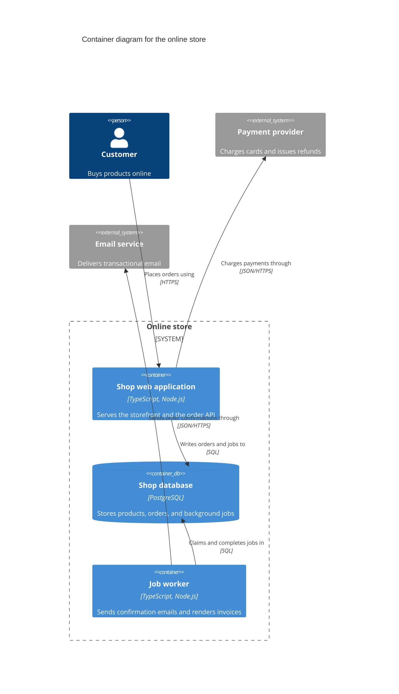

# Architecture decision examples

## A filled ADR

The shop is one TypeScript service with one PostgreSQL database. The user approved a plan that moves email and invoice work out of the checkout request into background jobs. The file is `docs/decisions/0007-use-postgresql-table-for-background-jobs.md`.

```markdown
---
status: "accepted"
date: 2026-03-04
---

# Use a PostgreSQL table for background jobs

## Context and Problem Statement

Checkout sends the order confirmation email and renders the invoice PDF inside the HTTP request. A slow email provider makes checkout slow, and a provider outage fails the order. The shop runs as one service with one PostgreSQL database and is operated by a team of three. Where should work that can happen after the response be queued and run?

## Decision Drivers

* Functional suitability, functional correctness. A job exists only when its order has committed.
* Reliability, recoverability. A queued job survives a crash or a deploy and runs afterwards.
* Maintainability. The team runs no infrastructure beyond the service and its database.
* Performance efficiency, capacity. The queue handles the current peak of about 20,000 jobs a day, estimated from last quarter's order volume.

## Considered Options

* Job table in the existing PostgreSQL database, claimed with `FOR UPDATE SKIP LOCKED`
* Redis with a job queue library
* RabbitMQ

## Decision Outcome

Chosen option: "Job table in the existing PostgreSQL database", because it is the only option that writes the job in the same transaction as the order, and it adds no infrastructure to run.

### Consequences

* Good, because a job exists if and only if its order committed.
* Good, because the existing database backups and monitoring cover the jobs.
* Bad, because polling workers add load to the database that serves checkout.
* Bad, because another service could only consume these jobs by reading this service's tables.

### Confirmation

An integration test rolls back an order and asserts that no job row exists. Code review rejects any job that is enqueued outside the order transaction.
```

The status is `accepted` because the user approved the plan that contained the decision.

## A C4 container diagram

This diagram matches the ADR above.



Key. Each box shows its type and technology.
Grey boxes are systems outside the online store.
Cylinders are databases.
Each arrow points from the element that starts the interaction.
